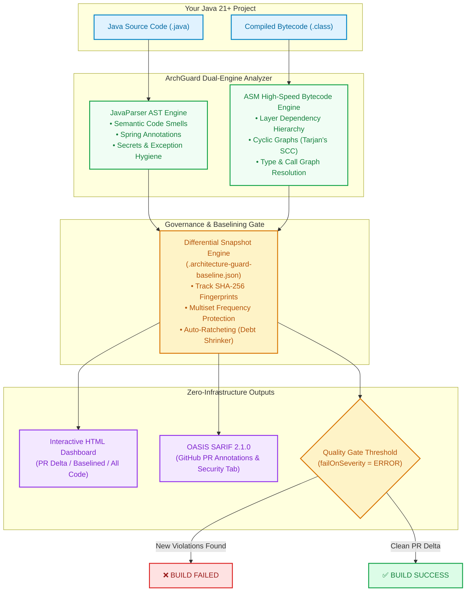

# 🛡️ ArchGuard — Features & Competitive Landscape

<p align="center">
  
  
  
  
  
  
  
</p>

> **The Next-Generation Architecture Governance, Spring Boot Intelligence & Zero-Infrastructure Code Quality Gate.**

<p align="center">
  <a href="https://github.com/javatechgroup/archGaurdDocs">⭐ <b>Star on GitHub</b></a> &bull; 
  <a href="#11-get-started-in-under-60-seconds">⚡ <b>Quick Start (60s)</b></a> &bull; 
  <a href="#3-head-to-head-comparison-matrix">📊 <b>Comparison vs SonarQube &amp; ArchUnit</b></a> &bull; 
  <a href="https://github.com/javatechgroup/archGaurdDocs/issues">💬 <b>Post Issue / Request Feature</b></a>
</p>

---

## 📑 Table of Contents
1. [The "Why ArchGuard?" Problem Statement](#1-the-why-archguard-problem-statement)
2. [How It Works: Hybrid Dual-Engine Architecture](#2-how-it-works-hybrid-dual-engine-architecture)
3. [Head-to-Head Comparison Matrix](#3-head-to-head-comparison-matrix)
4. [In-Depth Tool Battles](#4-in-depth-tool-battles)
   - [ArchGuard vs SonarQube / SonarCloud](#1-archguard-vs-sonarqube--sonarcloud)
   - [ArchGuard vs ArchUnit](#2-archguard-vs-archunit)
   - [ArchGuard vs SpotBugs / FindBugs](#3-archguard-vs-spotbugs--findbugs)
   - [ArchGuard vs Checkstyle & PMD](#4-archguard-vs-checkstyle--pmd)
5. [Top 5 "Killer Capabilities"](#5-top-5-killer-capabilities)
6. [OWASP Top 10 Security & Governance Alignment](#6-owasp-top-10-security--governance-alignment-what-archguard-covers-and-what-it-doesnt)
7. [Memory & Resource Safety: Root-Cause Detection](#7-memory--resource-safety-what-archguard-detects-and-what-it-doesnt)
8. [Complete 33-Rule Quality Catalog (AG001 – AG033)](#8-complete-33-rule-quality-catalog-ag001--ag033)
9. [Enterprise Developer Experience & Reporting](#9-enterprise-developer-experience--reporting)
10. [Enterprise Scalability & Performance Benchmarks](#10-enterprise-scalability--performance-benchmarks)
11. [Get Started in Under 60 Seconds](#11-get-started-in-under-60-seconds)
12. [Next-Gen Strategic Roadmap](#12-next-gen-strategic-roadmap)

---

## 1. The "Why ArchGuard?" Problem Statement

Every software engineering team runs linters and quality gates. Yet, production outages, memory leaks, and architectural erosion still occur every single day in enterprise Spring Boot services:

```
❌ A @Transactional method calls another @Transactional method in the same class (proxy bypass)
   👉 Result: Transaction never commits; silent data corruption in production!

❌ A singleton @Service contains a non-final List or SimpleDateFormat
   👉 Result: Multi-threaded race conditions; User A sees User B's private account data!

❌ A @RestController returns a JPA @Entity directly instead of a DTO/Record
   👉 Result: Mass-assignment vulnerability, Cartesian N+1 DB explosion, LazyInitializationException!

❌ A team turns on a quality gate on a 5-year-old enterprise application
   👉 Result: 3,400 legacy violations trigger build failures; developers revolt and disable the tool!
```

### Why Existing Tools Leave You Exposed:
- **Linters (Checkstyle, PMD):** Only inspect text and basic syntax. They don't understand compiled bytecode, type hierarchies, or Spring proxies.
- **Bug Finders (SpotBugs):** Only inspect isolated bytecode patterns. They have zero awareness of layered architecture or Spring bean scopes.
- **Enterprise Suites (SonarQube):** Require heavy server installations, databases, cloud licensing, and network roundtrips, while missing Spring-specific runtime traps.
- **Testing Libraries (ArchUnit):** Require writing and maintaining hundreds of lines of imperative JUnit test code with zero built-in differential debt ratcheting.

### 💡 The ArchGuard Solution:
**ArchGuard** is built from the ground up specifically for **Modern Java 21+ and Spring Boot 3+**. It combines **ASM Bytecode Analysis** with **JavaParser AST Inspection** into a single, lightning-fast Maven and Gradle plugin with zero server infrastructure, automated ratcheting baselines, and native GitHub SARIF integration.

---

## 2. How It Works: Hybrid Dual-Engine Architecture

ArchGuard executes directly in the build lifecycle (`mvn verify` or `./gradlew check`) in milliseconds without sending code over the network:



---

## 3. Head-to-Head Comparison Matrix

| Capability / Feature | 🛡️ **ArchGuard** | 🏢 **SonarQube** | 📐 **ArchUnit** | 🐛 **SpotBugs** | 🎨 **Checkstyle / PMD** |
| :--- | :---: | :---: | :---: | :---: | :---: |
| **Server / Cloud Infrastructure** | **None (100% Embedded)** | Heavy Server + DB | None (JUnit tests) | None (Plugin) | None (Plugin) |
| **Execution Speed** | **~2–7 seconds (In-Process)** | Minutes (Server queue + DB) | Test suite overhead | Fast (~5–15s) | Fast (~5–10s) |
| **Cost & Licensing** | **100% Free & Open Source** | Expensive Enterprise Tier | Free & Open Source | Free & Open Source | Free & Open Source |
| **Spring Proxy Self-Invocation (`AG021`)** | ✅ **Built-in Native** | ❌ None | ⚠️ Custom test code | ❌ None | ❌ None |
| **Spring Singleton Race Conditions (`AG022`)**| ✅ **Built-in Native** | ⚠️ Static only | ⚠️ Custom test code | ⚠️ Static only | ❌ None |
| **Direct JPA Entity REST Leakage (`AG012`)** | ✅ **Built-in Native** | ❌ None | ⚠️ Custom test code | ❌ None | ❌ None |
| **Architectural Layer Enforcement** | ✅ **Declarative YAML** | ⚠️ Enterprise only | ✅ Java DSL unit tests| ❌ None | ⚠️ Basic imports |
| **Cyclic Dependency Detection (Cycles)** | ✅ **Package & Class** | ✅ Project level | ✅ Package level | ❌ None | ❌ None |
| **Missing `@Transactional` Boundary (`AG009`)**| ✅ **Built-in Native** | ❌ None | ⚠️ Custom test code | ❌ None | ❌ None |
| **JPA Eager Fetch / N+1 Risk (`AG014`)** | ✅ **Built-in Native** | ❌ None | ⚠️ Custom test code | ❌ None | ❌ None |
| **Differential Baselining (PR Delta)** | ✅ **Multiset Snapshot** | ✅ New Code Period | ❌ None | ⚠️ XML Filter | ⚠️ Suppressions |
| **Automatic Debt Ratcheting** | ✅ **Built-in Mode** | ❌ Manual tuning | ❌ None | ❌ None | ❌ None |
| **Baseline Refactor Resilience** | ✅ **Two-Pass Semantic (Zero-Drift)** | ⚠️ Fragile Git-diff shifts | ❌ No baseline | ❌ Breaks on line shifts | ❌ Breaks on line shifts |
| **Interactive Offline HTML Dashboard** | ✅ **Included (Zero CDN)**| ❌ Web server only | ❌ None | ⚠️ Basic static | ⚠️ Basic static |
| **GitHub Security / SARIF 2.1.0** | ✅ **Native Output** | ⚠️ Plugin / Action | ❌ None | ⚠️ Via plugin | ⚠️ Via plugin |
| **Setup Time** | **< 60 Seconds (Zero-Config)** | Hours / Days | Hours writing tests | 10 Minutes | 10 Minutes |

---

## 4. In-Depth Tool Battles

### 1. ArchGuard vs SonarQube / SonarCloud

| Comparison Vector | 🛡️ ArchGuard | 🏢 SonarQube |
| :--- | :--- | :--- |
| **Infrastructure Overhead** | **Zero.** Executes directly inside your Maven or Gradle build. No Docker containers, no PostgreSQL instance, no webhook management. | **High.** Requires provisioning and maintaining an application server, dedicated database, network firewalls, and security tokens. |
| **Spring Boot Awareness** | **Engineered for Spring Boot 3+.** Understands proxy boundaries, singleton thread hazards, `@Transactional` scopes, and REST security boundaries. | **Generic Java.** Treats Spring like any plain Java code. Completely misses proxy self-invocation and REST entity exposure. |
| **Feedback Loop Speed** | **Immediate (Shift-Left).** Delivered in-process in your local terminal during build in ~2–7 seconds. | **Asynchronous.** Code bundle uploaded to server; results available after server worker queue processing and DB indexing. |
| **Cost & PR Decoration** | **100% Free.** Generates SARIF 2.1.0 reports that natively decorate PR lines in GitHub Actions for free. | **Paywalled.** Pull request decoration and branch analysis are locked behind paid Developer/Enterprise editions. |

> **Verdict:** Use **ArchGuard** as your zero-friction, Spring-intelligent gatekeeper directly in local builds and PR pipelines (shift-left). Use SonarQube for broad multi-language portfolio tracking and enterprise reporting if you already host the centralized infrastructure.

---

### 2. ArchGuard vs ArchUnit

| Comparison Vector | 🛡️ ArchGuard | 📐 ArchUnit |
| :--- | :--- | :--- |
| **Configuration vs Coding** | **Zero-Config & Declarative.** Works out of the box with zero files. Optional `archguard.yml` (via `mvn architecture-guard:init`) for custom overrides. Zero test code needed. | **Programmatic.** Developers must write, compile, and maintain verbose JUnit unit tests (`classes().that().resideInAPackage()...`). |
| **Legacy Technical Debt** | **Built-in Ratchet Engine.** Freeze legacy debt with `mvn architecture-guard:baseline` or `./gradlew archGuardBaseline` in 1 second. | **No native baseline.** Teams must either fix all legacy violations before adding a rule or write complex custom ignore logic. |
| **Rule Breadth** | Covers architecture, Spring runtime traps, clean code metrics, secrets, and performance anti-patterns out of the box. | Strictly limited to architectural dependency and reflection assertions. |
| **Reporting & Dashboards** | Rich interactive HTML dashboard + SARIF 2.1.0 export. | Standard JUnit assertion failure messages in unit test logs. |

> **Verdict:** ArchGuard provides a complete out-of-the-box governance product with UI, baselines, and SARIF, whereas ArchUnit is a testing library requiring custom test code.

---

### 3. ArchGuard vs SpotBugs / FindBugs

| Comparison Vector | 🛡️ ArchGuard | 🐛 SpotBugs |
| :--- | :--- | :--- |
| **Context & Architecture** | Analyzes full architectural layer graphs, package boundaries, and Spring component lifecycles. | Analyzes low-level bytecode patterns in isolation without architectural context. |
| **Developer Experience** | Modern YAML configuration, clean terminal diffs, and an interactive modern HTML UI. | Complex XML suppression filters and 2000s-era static HTML reports. |

---

### 4. ArchGuard vs Checkstyle & PMD

| Comparison Vector | 🛡️ ArchGuard | 🎨 Checkstyle & PMD |
| :--- | :--- | :--- |
| **Analysis Depth** | Dual-Engine: ASM Bytecode + AST Source. Resolves actual class hierarchies and cross-package references. | Source AST and text pattern matching only. Cannot resolve true compiled bytecode types. |
| **Focus Area** | Framework safety, architectural integrity, and runtime concurrency bugs. | Code style, indentation, naming conventions, and cosmetic formatting. |

---

## 5. Top 5 "Killer Capabilities"

### 🔥 1. Spring AOP Proxy Self-Invocation Hunter (`AG021`)
In Spring, `@Transactional`, `@Async`, `@Cacheable`, `@Retryable`, and `@Scheduled` work via dynamic AOP proxies. When a method calls another annotated method in the **same class** (`this.method()`), Spring proxies are bypassed silently.

```java
// ❌ SILENT PRODUCTION DISASTER: The @Transactional proxy is bypassed!
@Service
public class OrderService {
    public void processAll(List<Order> orders) {
        for (Order order : orders) {
            saveWithAudit(order); // Calls directly via 'this', bypassing Spring proxy!
        }
    }

    @Transactional // NEVER OPENS A TRANSACTION WHEN CALLED FROM processAll()!
    public void saveWithAudit(Order order) {
        orderRepo.save(order);
        auditRepo.record(order);
    }
}
```
> **ArchGuard catches this instantly during build and suggests extracting the transactional boundary into an injected bean or programmatic `TransactionTemplate`.**

---

### 🔥 2. Singleton Bean Concurrency & Mutable State Guard (`AG022`)
Spring Beans are singletons shared across concurrent HTTP request worker threads. Defining mutable instance state or non-thread-safe utilities in `@Service` or `@Component` leads to catastrophic data leaks.

```java
// ❌ RACE CONDITION: Shared across all concurrent HTTP requests!
@Service
public class PaymentProcessingService {
    private List<Payment> recentPayments = new ArrayList<>(); // Corrupted under concurrency!
    private SimpleDateFormat sdf = new SimpleDateFormat("yyyy-MM-dd"); // Throws NumberFormatException / cross-talk!
    private int transactionCounter = 0; // Lost updates!
}
```
> **ArchGuard flags non-final mutable fields in Spring singletons and mandates thread-safe alternatives (`java.time.DateTimeFormatter`, scoped state, or concurrent collections).**

---

### 🔥 3. Zero-Fatigue Differential Baselining with Auto-Ratcheting
Adopting quality gates in large enterprise codebases usually fails because developers are overwhelmed by thousands of legacy warnings they didn't write.

```bash
# Day 1: Freeze all legacy technical debt in 1 command
mvn architecture-guard:baseline
# Or in Gradle:
./gradlew archGuardBaseline
```

1. **Only New Debt Fails the Build:** PRs only fail if the developer adds **new** violations.
2. **Multiset Protection:** If a legacy class has 1 warning, adding a 2nd warning in the same file is recognized as **new** debt and blocked!
3. **Automatic Ratchet (`-Darchguard.ratchet=true`):** As developers refactor and clean up old code, the baseline snapshot shrinks automatically. **Technical debt can only decrease, never increase.**
4. **Two-Pass Semantic Matching (Zero-Drift Baseline):** Unlike naive tools whose baselines break whenever lines shift or methods are edited, ArchGuard pairs exact SHA-256 fingerprints (Pass 1) with semantic identity keys (Pass 2):
   - **Metric Fluctuation Resilience:** Adding lines inside a baselined monster method (`AG020`), adding branches to a complex method (`AG018`), or injecting collaborators (`AG017`) will **never** trigger false "new violations" or false "resolved debt."
   - **Refactoring Resilience:** Renaming variables, `@RequestBody` parameters (`AG015`), exception catch variables (`e` → `ex` in `AG008`), or moving code lines around preserves existing baseline identity.

---

### 🔥 4. REST API & Domain Boundary Firewall (`AG001`, `AG012`, `AG015`, `AG016`)
Protects your application's external API boundary and internal domain model:

```java
// ❌ ARCHITECTURAL BREACH & SECURITY VULNERABILITY
@RestController
public class UserController {
    @Autowired
    private UserRepository userRepository; // AG001: Controller directly touches DB!

    @GetMapping("/users")
    public List<UserEntity> getAllUsers() { // AG012: JPA Entity exposed! AG016: Unpaginated List!
        return userRepository.findAll();
    }

    @PostMapping("/users")
    public UserEntity createUser(@RequestBody UserEntity user) { // AG015: Missing @Valid!
        return userRepository.save(user);
    }
}
```
> **ArchGuard enforces clean architecture: Controllers talk only to Services, expose Java 21 Records/DTOs, enforce `@Valid` request bodies, and return paginated collections (`Page<T>`).**

---

### 🔥 5. Zero-Infrastructure Native GitHub SARIF 2.1.0 & HTML Dashboard
No server to host, no license keys, no Docker containers:
- **GitHub PR Inline Annotations:** Generates standard OASIS SARIF 2.1.0 uploaded via `github/codeql-action/upload-sarif@v3`. Annotations appear directly on the changed lines of your GitHub Pull Request.
- **Security Tab Integration:** All architecture and security violations populate the native **GitHub Security → Code Scanning** dashboard for free on public repositories.
- **Offline Interactive HTML Dashboard:** Self-contained report with zero CDN dependencies, live filtering by scope (**PR Delta**, **Baselined Debt**, **All Code**), dark/light theme, and copy-paste remediation code.

---

## 6. OWASP Top 10 Security & Governance Alignment (What ArchGuard Covers, and What It Doesn't)

To maintain absolute technical transparency and enterprise credibility, here is an exact breakdown of how ArchGuard addresses the **OWASP Top 10 (2021 Standard)** and where it sits within a defense-in-depth enterprise security program:

### 📊 OWASP Top 10 Alignment Matrix

| OWASP Top 10 Category | Direct Rule Coverage | CWE Mappings | ArchGuard Architectural Mechanism |
| :--- | :---: | :--- | :--- |
| **A01: Broken Access Control** | [`AG012`](../rules/AG012-direct-entity-exposure.md), [`AG001`](../rules/AG001-controller-to-repository.md), [`AG002`](../rules/AG002-controller-to-controller.md) | CWE-200, CWE-284, CWE-862 | Forbids JPA `@Entity` in REST payloads (Mass Assignment) and enforces service-layer authorization flow. |
| **A02: Cryptographic Failures** | [`AG032`](../rules/AG032-broken-crypto.md), [`AG013`](../rules/AG013-hardcoded-secret.md) | CWE-259, CWE-327, CWE-328 | Flags deprecated hashing (`MD5`, `SHA-1`), weak ciphers (`DES`, `RC4`, `ECB`), and Shannon-entropy secrets. |
| **A03: Injection** | [`AG031`](../rules/AG031-dynamic-query-concatenation.md), [`AG015`](../rules/AG015-missing-valid-annotation.md) | CWE-89, CWE-20 | AST detection of runtime query concatenation in `@Query`, `EntityManager`, `JdbcTemplate`; mandates `@Valid`. |
| **A04: Insecure Design** | [`AG016`](../rules/AG016-unpaginated-collection.md), [`AG026`](../rules/AG026-remote-io-in-transaction.md), [`AG029`](../rules/AG029-unbounded-async-threadpool.md), [`AG030`](../rules/AG030-missing-http-client-timeout.md) | CWE-1053, CWE-1059, CWE-400 | Mitigates Denial-of-Service (DoS), connection pool exhaustion, and thread hang cascades. |
| **A05: Security Misconfiguration** | [`AG033`](../rules/AG033-insecure-cors.md), [`AG011`](../rules/AG011-direct-console-output.md) | CWE-942, CWE-532 | Flags wildcard CORS (`*`) with `allowCredentials=true`; forbids unmanaged `System.out`/`printStackTrace`. |
| **A06: Vulnerable Components** | *Delegated to SCA* | CWE-1104 | *Intentionally delegated to dedicated SCA tools (e.g. OWASP Dependency-Check Maven Plugin).* |
| **A07: Identification Failures** | [`AG013`](../rules/AG013-hardcoded-secret.md), [`AG033`](../rules/AG033-insecure-cors.md) | CWE-287, CWE-384 | Eliminates hardcoded admin tokens/keys; prevents cross-origin session/credential interception. |
| **A08: Software & Data Integrity** | [`AG010`](../rules/AG010-unsafe-mutable-static.md), [`AG021`](../rules/AG021-spring-proxy-self-invocation.md), [`AG022`](../rules/AG022-singleton-mutable-state.md), [`AG028`](../rules/AG028-threadlocal-leak.md) | CWE-494, CWE-502 | Prevents multi-tenant state leaks in singletons, ThreadLocal worker context leaks, and proxy bypasses. |
| **A09: Security Logging Failures** | [`AG008`](../rules/AG008-swallowed-exception.md), [`AG011`](../rules/AG011-direct-console-output.md) | CWE-390, CWE-778 | Forbids swallowed exceptions that conceal attacks; mandates structured SLF4J logging for SIEM ingestion. |
| **A10: Server-Side Request Forgery**| [`AG030`](../rules/AG030-missing-http-client-timeout.md) | CWE-918 | Mitigates hanging thread exhaustion from SSRF probes targeting internal unresponsive IP endpoints. |

---

### ✅ What ArchGuard Handles (Static Code Root-Cause Analysis)
ArchGuard detects security hazards at the source AST and bytecode level where precision can be guaranteed with **100% confidence and zero false positives**:

1. **Dynamic SQL/JPQL Injection (`AG031` / OWASP A03 / CWE-89):**
   - Flags runtime string concatenation in Spring Data `@Query`, JPA `EntityManager.createQuery/createNativeQuery`, Spring `JdbcTemplate`, and JDBC `prepareStatement`.
   - *Zero False Positive Guarantee:* Multi-line constant strings (`"SELECT ... " + "FROM ..."`) and `ALL_CAPS` static constants are automatically recognized via compile-time constant folding and exempted.
2. **Broken Cryptography & Weak Ciphers (`AG032` / OWASP A02 / CWE-327):**
   - Detects obsolete hash algorithms (`MD5`, `SHA-1`) passed to `MessageDigest.getInstance()` and weak ciphers (`DES`, `RC4`, or insecure `AES/ECB` mode) passed to `Cipher.getInstance()`.
   - *Zero False Positive Guarantee:* Evaluates only cryptographic API calls. Mentions of "MD5" in log messages, variable names, or HTTP headers are never flagged.
3. **Insecure CORS Wildcard Policies (`AG033` / OWASP A05 / CWE-942):**
   - Detects Cross-Origin Resource Sharing configurations that combine wildcard origins (`*`) with credential forwarding (`allowCredentials=true`).
   - Flags this both at the individual controller/endpoint level (`@CrossOrigin`) and centralized `WebMvcConfigurer.addCorsMappings` call chains.
4. **Hardcoded Secrets & API Keys (`AG013` / OWASP A02 / CWE-259):**
   - Scans source code for committed private keys, JWT signing secrets, database credentials, and cloud API tokens using Shannon entropy and specialized regex heuristics.
5. **REST JPA Mass Assignment & Sensitive Field Exposure (`AG012` / OWASP A01 / CWE-200):**
   - Forbids exposing JPA `@Entity` classes directly in REST controller methods. Mandates strict Data Transfer Objects (DTOs / Records) to prevent attackers from overwriting internal audit flags or roles via JSON injection.
6. **ThreadLocal Security Context Contamination (`AG028` / OWASP A08):**
   - Enforces `.remove()` calls inside guaranteed `finally` blocks for `ThreadLocal` instances, preventing security contexts or tenant identities from bleeding into subsequent user requests on recycled web container worker threads.
7. **Silent Exception Swallowing & Concealed Attacks (`AG008` / OWASP A09 / CWE-390):**
   - Prohibits empty `catch` blocks that silently discard security exceptions, authentication errors, or system failures without logging or rethrowing.

---

### ❌ What ArchGuard Intentionally Delegates (Transparent Boundaries)
ArchGuard is designed as an architectural and code-level gatekeeper. It intentionally does not attempt to duplicate specialized external security systems:
- **Third-Party Dependency CVEs (OWASP A06):** Inspecting transitive `.jar` dependencies against the National Vulnerability Database (NVD) is best handled by dedicated Software Composition Analysis (SCA) tools (such as the *OWASP Dependency-Check Maven Plugin* or *GitHub Dependabot*). ArchGuard focuses on your proprietary source code and architecture.
- **Runtime Identity & Access Management (OWASP A07):** Password complexity validation, MFA, brute-force rate-limiting, and OAuth2/JWT signature verification belong in dedicated IAM frameworks (*Spring Security*, *Keycloak*, *Okta*).
- **Network-Level SSRF & Egress Filtering (OWASP A10):** Restricting outbound network requests to approved subnets or internal metadata services belongs in egress firewalls, API Gateways, and Web Application Firewalls (WAFs).

---

## 7. Memory & Resource Safety: What ArchGuard Detects (and What It Doesn't)

To maintain absolute technical integrity, here is an exact, transparent breakdown of how ArchGuard addresses memory and resource hazards:

### ✅ What ArchGuard Handles (Static Code Root-Cause Analysis)
ArchGuard detects the **static code patterns and architectural smells** that directly trigger JVM memory leaks, native resource exhaustion, and `OutOfMemoryError` (OOM) crashes in production:

1. **Unbounded Static Memory Accumulation (`AG010`):**
   - Non-final static fields or mutable collections (`static List<T>`, `static Map<K,V>`).
   - *Why it matters:* In the JVM, static variables are attached directly to classloader GC roots and **never garbage-collected**, creating permanent memory leaks across HTTP requests.
2. **Spring Singleton Bean Memory Retention (`AG022`):**
   - Mutable instance collections and non-thread-safe state inside `@Service`, `@Component`, or `@RestController` beans.
   - *Why it matters:* Because Spring singleton beans live for the entire application lifecycle, accumulating data in instance fields causes unbounded heap growth.
3. **OS File Descriptor & Connection Pool Leaks (`AG024`):**
   - Instantiating `AutoCloseable` streams (`FileInputStream`, `FileOutputStream`, `BufferedReader`) or JDBC resources (`Connection`, `Statement`, `ResultSet`) outside a **try-with-resources** block.
   - *Why it matters:* Exceptions before an explicit `.close()` leak OS file handles, sockets, and pool connections, leading to crash states.
4. **JVM OutOfMemoryError via Unbounded Database Queries (`AG016`):**
   - Returning raw `List<T>` from REST endpoints instead of `Page<T>` or slice pagination.
   - *Why it matters:* Fetching 100,000+ records in a single HTTP request forces the JVM to materialize massive object graphs in heap, causing sudden `java.lang.OutOfMemoryError: Java heap space`.
5. **Garbage Collection (GC) Thrashing from String Concatenation (`AG025`):**
   - Using `+` or `+=` inside loops (`for`, `while`).
   - *Why it matters:* Repeated concatenation creates $N$ intermediate immutable `String` instances on every iteration, leading to $O(n^2)$ heap allocation and frequent Stop-The-World GC pauses.
6. **Cartesian Product Heap Bloat (`AG014`):**
   - Using JPA `FetchType.EAGER` relationships.
   - *Why it matters:* Eager joins trigger Cartesian product query returns from the database, loading thousands of redundant entities into the JVM heap.
7. **ThreadLocal Memory Leaks & Worker Contamination (`AG028`):**
   - Calling `ThreadLocal.set()` without guaranteed `.remove()` in an enclosing `finally` block.
   - *Why it matters:* Web containers (Tomcat, Jetty, Undertow) recycle worker threads from fixed thread pools. Uncleaned `ThreadLocal` entries remain pinned to `Thread` objects indefinitely, leading to classloader memory leaks and cross-request user/tenant context leaks.
8. **Unbounded Thread Allocation & Native Thread Starvation (`AG029`):**
   - Using `@Async` without an explicit `ThreadPoolTaskExecutor` qualifier.
   - *Why it matters:* Defaulting to `SimpleAsyncTaskExecutor` spawns an unbounded new OS thread for every single asynchronous task call, triggering `java.lang.OutOfMemoryError: unable to create new native thread` under load.

### ❌ What ArchGuard Does NOT Handle (Transparent Boundaries)
ArchGuard is a **static analysis code gate**, not a runtime JVM profiler:
- **No Dynamic Heap Dump Analysis:** ArchGuard does not inspect live JVM heap dumps (`.hprof`), JVM flags (`-Xmx`, `-Xms`), or live object retention trees. (Use tools like *Eclipse MAT* or *YourKit* for post-mortem heap dump profiling).
- **No Live Memory Allocation Profiling:** ArchGuard cannot measure the dynamic runtime byte size of objects in flight. (Use *JProfiler* or *VisualVM* for runtime telemetry).
- **No Native Memory Profiling:** ArchGuard does not track off-heap JNI/C++ allocations.

---

## 8. Complete 33-Rule Quality Catalog (AG001 – AG033)

> **Summary:** 33 Total Rules &bull; `🔴 16 ERROR (Blocks Build)` &bull; `🟡 17 WARNING (Code Hygiene & Quality)`

Every rule includes automated diagnostic detection, exact line numbers, and actionable remediation suggestions:

### 🏛️ Category 1: Architecture & Modular Boundaries
- `🔴 ERROR` &bull; **`[AG001]` Controller to Repository Direct Dependency:** Enforces service layer orchestration; forbids controllers from bypassing service logic to touch DB directly.
- `🔴 ERROR` &bull; **`[AG002]` Controller to Controller Direct Dependency:** Forbids web controllers from depending on or calling other controllers directly.
- `🔴 ERROR` &bull; **`[AG003]` Service to Controller Inverted Dependency:** Prohibits low-level or business service layer from depending upwards on presentation controllers.
- `🔴 ERROR` &bull; **`[AG004]` Repository to Service Inverted Dependency:** Forbids persistence layer components from coupling upwards to service orchestration.
- `🔴 ERROR` &bull; **`[AG005]` Class-Level Cyclic Dependency:** Detects cyclic dependency loops (A $\to$ B $\to$ A) using Tarjan's Strongly Connected Components algorithm.
- `🔴 ERROR` &bull; **`[AG006]` Package Boundary Violation:** Enforces modular encapsulation and package access restrictions between bounded contexts.

### 🌱 Category 2: Spring Boot & Concurrency Hazards
- `🟡 WARNING` &bull; **`[AG007]` Field Injection (`@Autowired`):** Mandates constructor injection for immutability and easier unit testing.
- `🟡 WARNING` &bull; **`[AG009]` Missing `@Transactional` on Mutating Methods:** Flags public service methods executing repository writes without transaction boundaries.
- `🔴 ERROR` &bull; **`[AG010]` Unsafe Mutable Static State:** Forbids mutable static fields/collections that corrupt state in multi-threaded server runtimes.
- `🔴 ERROR` &bull; **`[AG021]` Spring Self-Invocation Proxy Bypass:** Detects internal `this.method()` calls that silently bypass `@Transactional`, `@Async`, or `@Cacheable` proxies.
- `🔴 ERROR` &bull; **`[AG022]` Singleton Bean Mutable Instance State:** Prevents race conditions and cross-request data leaks caused by mutable state in `@Service` singletons.
- `🔴 ERROR` &bull; **`[AG026]` Remote I/O in `@Transactional` Boundary:** Prevents HikariCP connection pool starvation and outages caused by remote HTTP/REST/SDK calls inside transactions.
- `🟡 WARNING` &bull; **`[AG027]` Java 21 Virtual Thread Pinning:** Detects `synchronized` methods/blocks that pin OS carrier threads in Project Loom, degrading virtual thread throughput.
- `🔴 ERROR` &bull; **`[AG028]` ThreadLocal Memory Leak & Context Contamination:** Flags `ThreadLocal.set()` without guaranteed `remove()` in a `finally` block to protect pooled worker threads.
- `🟡 WARNING` &bull; **`[AG029]` Unbounded `@Async` Thread Pool Exhaustion:** Prevents native OS thread starvation by ensuring `@Async` methods declare a bounded `ThreadPoolTaskExecutor`.

### 🌐 Category 3: REST API & Data Governance
- `🔴 ERROR` &bull; **`[AG012]` Direct Entity Exposure in REST API:** Forbids JPA `@Entity` classes in REST controller endpoints, preventing mass-assignment and lazy-loading crashes.
- `🟡 WARNING` &bull; **`[AG014]` JPA Eager Fetch / N+1 Query Risk:** Prohibits `FetchType.EAGER` to prevent Cartesian explosion SQL queries.
- `🟡 WARNING` &bull; **`[AG015]` Missing `@Valid` on REST `@RequestBody`:** Ensures all mutation endpoints enforce Bean Validation constraints.
- `🟡 WARNING` &bull; **`[AG016]` Unpaginated Collections in REST APIs:** Enforces `Page<T>` returns instead of unbounded `List<T>` to prevent OOM errors.

### 🔒 Category 4: Security, Resilience & Safety
- `🟡 WARNING` &bull; **`[AG008]` Swallowed Exception Blocks:** Forbids empty catches or caught exceptions that are neither logged nor rethrown.
- `🔴 ERROR` &bull; **`[AG013]` Hardcoded Secrets Scanner:** High-entropy scanner detecting committed credentials, API tokens, and AWS keys.
- `🟡 WARNING` &bull; **`[AG023]` NullPointer Traps & Defensive Coding:** Flags raw `Optional.get()`, methods returning `null` instead of empty collections, and inverted equality checks.
- `🔴 ERROR` &bull; **`[AG024]` Unclosed AutoCloseable Resource Leaks:** Enforces try-with-resources for I/O streams, readers, and JDBC resources.
- `🔴 ERROR` &bull; **`[AG030]` Missing HTTP Client Timeout Configuration:** Eliminates worker thread starvation by ensuring `RestTemplate`, `RestClient`, and `HttpClient` configure explicit connection and read timeouts.
- `🔴 ERROR` &bull; **`[AG031]` Dynamic Query Concatenation Injection Risk:** Detects dynamic variable concatenation into SQL/JPQL statements in `@Query`, `EntityManager`, or `JdbcTemplate` creating SQL injection risks (OWASP A03).
- `🔴 ERROR` &bull; **`[AG032]` Broken Cryptographic Algorithm:** Flags usage of deprecated, collision-prone hashing (`MD5`, `SHA-1`) or weak ciphers (`DES`, `RC4`, `ECB` mode) (OWASP A02).
- `🔴 ERROR` &bull; **`[AG033]` Insecure CORS Configuration:** Flags CORS configurations combining wildcard origins (`*`) with credential forwarding (`allowCredentials=true`) (OWASP A05).

### ⚡ Category 5: Performance & Clean Code
- `🟡 WARNING` &bull; **`[AG011]` Direct Console Logging:** Eliminates `System.out.println` and `e.printStackTrace()` in favor of structured logging.
- `🟡 WARNING` &bull; **`[AG017]` Injected Dependency Bloat / God Class:** Flags classes with $\ge 7$ injected collaborators violating Single Responsibility.
- `🟡 WARNING` &bull; **`[AG018]` High Cyclomatic Complexity:** Enforces clean, testable code by flagging methods with complexity $> 15$.
- `🟡 WARNING` &bull; **`[AG019]` Algorithmic Performance Risk:** Flags linear collection searches ($O(n)$) or database queries inside loops.
- `🟡 WARNING` &bull; **`[AG020]` Code Readability & Arrow Anti-patterns:** Flags monster methods ($> 60$ lines), bloated files ($> 450$ lines), and deep nesting ($\ge 4$ levels).
- `🟡 WARNING` &bull; **`[AG025]` Loop String Concatenation:** Flags `+` or `+=` string concatenation inside loops that cause $O(n^2)$ heap allocation churn.

---

## 9. Enterprise Developer Experience & Reporting

### 📊 1. Interactive Offline HTML Dashboard
Generated at `target/architecture-guard/architecture-guard-report.html` (Maven) or `build/reports/architecture-guard/architecture-guard-report.html` (Gradle):
- **Self-Contained & Zero CDN:** 100% standalone single-file HTML report with embedded CSS/JS that renders completely offline inside air-gapped enterprise environments.
- **Rule Sidebar "Issues Only" Toggle:** Reviewers can toggle between **`⚠️ Issues Only`** (shows only the subset of rules with active findings) and **`All Rules`** (full 33-rule catalog), with live rule search.
- **Auditable Suppressed Scope:** Dedicated **`🛡️ Suppressed (N)`** tab displays code-suppressed violations with distinct **`🛡️ SUPPRESSED IN CODE`** badges without polluting the active quality gate numbers.
- **One-Click IDE Deep Links:** Normalized links (`vscode://file/...` and `idea://open?file=...`) open the exact file and line directly in VS Code or IntelliJ IDEA on Windows, macOS, and Linux.
- **Zero-Results Filter Empty State:** When filter combinations yield zero hits, a clean feedback box with **`↺ Reset All Filters`** restores the view instantly.
- **Dynamic Scope Filters:** Toggle between **Active**, **PR Delta** (new violations only), **Baselined Debt**, and **Suppressed** with instant metric updates.
- **Actionable Remediation Cards:** Every violation displays the exact file, line number, offending code snippet, and copyable remediation guidance.
- **Dark / Light Theme:** Seamless toggle with persistent local preference.

### 🐙 2. Native GitHub Actions PR Decoration
Upload standard OASIS SARIF 2.1.0 in just 3 lines of YAML:

```yaml
- name: Upload ArchGuard SARIF Report
  uses: github/codeql-action/upload-sarif@v3
  with:
    sarif_file: target/architecture-guard/report.sarif
    category: archguard
```

- **Inline Code Comments:** GitHub automatically places red warnings and error annotations on the exact lines of code modified in the Pull Request.
- **Security Dashboard:** Violations appear natively under the **Security → Code Scanning alerts** tab.

```
┌────────────────────────────────────────────────────────────────────────┐
│ Pull Request #142: Add Payment Orchestrator Service                    │
├────────────────────────────────────────────────────────────────────────┤
│ ❌ PaymentService.java:48 — ArchGuard [AG021]                         │
│ Method 'processPayment()' calls internal @Transactional method        │
│ 'saveAudit()' via 'this', bypassing Spring's transaction proxy.       │
│                                                                        │
│ Suggested Fix: Extract 'saveAudit()' into an injected bean or use      │
│ TransactionTemplate.execute(...).                                      │
└────────────────────────────────────────────────────────────────────────┘
```

### 🏷️ 3. Auditable In-Code Suppressions (Method & Class Level)
Suppress intentional architecture exceptions using either standard Java `@SuppressWarnings` or `@SuppressArchitecture`. Suppressed violations **do not break CI builds**, but remain 100% visible and auditable under the `🛡️ Suppressed` dashboard tab:

```java
// Method-Level Targeted Suppression (Recommended)
@SuppressWarnings({"archguard:AG018", "archguard:AG020"})
public void legacyBatchProcess() { ... }

// Method-Level Blanket Suppression (All ArchGuard Rules)
@SuppressWarnings("archguard")
public void uninspectedLegacyMethod() { ... }

// Class-Level Suppression with Audit Rationale
@SuppressArchitecture(
    rule = "AG024",
    reason = "Resource lifecycle is managed externally by Spring Batch framework"
)
public class LegacyExportService { ... }
```

### 📦 4. Multi-Module Reactor & Parent POM Support
- **Upward Config Discovery:** Child submodules automatically walk up the directory tree (up to 4 levels) to discover the root `archguard.yml`, eliminating config duplication.
- **Aggregator Clean Skip:** Modules with `<packaging>pom</packaging>` are skipped cleanly without false warnings about missing `target/classes`.

---

## 10. Enterprise Scalability & Performance Benchmarks

In enterprise CI/CD pipelines, build speed directly impacts developer flow. Lengthy verification phases introduce pipeline friction and frequently cause engineering teams to disable quality gates. ArchGuard is architected from the ground up to minimize CI overhead, operating in-process within the standard Maven and Gradle build lifecycle.

### ⏱️ Indicative Performance Profile: 1,000 Classes (~250,000 LOC)
*Representative timings observed on an 8-core developer workstation / multi-core CI runner with SSD storage:*

| Analysis Phase | Underlying Engine | Latency (1,000 Classes) | Algorithmic Complexity | Engineering Design Note |
| :--- | :--- | :---: | :---: | :--- |
| **Bytecode Ingestion & Dependency Extraction** | **Parallel ASM / ArchUnit** | **~180 – 300ms** | $O(N)$ parallel | Multithreaded bytecode dependency extraction across cores |
| **Semantic Source AST Inspection** | **Parallel JavaParser AST** | **~650 – 900ms** | $O(N)$ parallel streaming | Isolated per-worker visitor with immediate AST deallocation |
| **Dual-Engine Pipeline Overlap** | **ArchGuardTaskExecutor** | **Concurrent** | $\max(T_{\text{byte}}, T_{\text{ast}})$ | Bytecode & AST analysis run concurrently via managed thread pool |
| **Cyclic Dependency Resolution** | **Tarjan's SCC Graph** | **< 50ms** | $O(V + E)$ | Strictly linear strongly-connected-components traversal |
| **33 Quality, Spring & Security Rules** | **ArchGuard Core** | **~80 – 150ms** | $O(1)$ lookups | In-memory evaluation over pre-computed type & AST metadata |
| **Differential Baseline & Ratchet** | **SHA-256 Identity Multiset** | **< 5ms** | $O(1)$ lookups | Instantaneous identity-backed baseline snapshot matching |
| **Report Generation (HTML & SARIF)**| **Offline File Exporter** | **~150 – 200ms** | $O(V)$ | Direct streaming local file serialization (zero external HTTP calls) |
| **Total Wall-Clock Analysis Time** | | **~1.2 – 2.2 seconds** | — | ⚡ **Sub-3s turnaround in typical pull-request workflows** |

---

### 📊 Architectural Comparison: Local In-Process Gate vs. Centralized Platforms

```
Representative CI Feedback Turnaround (1,000 Classes, Multi-Core CI Runner)
─────────────────────────────────────────────────────────────────────────────
ArchGuard (Multithreaded In-Process Gate) █ 1.5s
PMD / Checkstyle (Local Source Linter)   ███ 8.0s
SpotBugs (Local Bytecode Analyzer)       ███████ 22.0s
Centralized Server Platform (SonarQube)*  ██████████████████████████████ ~180s (3m)
─────────────────────────────────────────────────────────────────────────────
*Note: Representative end-to-end turnaround including artifact bundling, network transfer,
worker queue scheduling, and centralized server-side database persistence.
```

### 🧠 Zero-OOM Memory Safety (Heap Footprint)
- **Transient AST Lifecycle (Zero-Retention):** ArchGuard never retains all 1,000 AST models simultaneously. Each source file is parsed, evaluated for findings, and immediately garbage-collected.
- **Ultra-Compact Bytecode Symbols:** ASM bytecode representations consume only ~30–45 KB per class (~35 MB for 1,000 classes).
- **Peak Heap Consumption:** Peak memory usage is **under 300 MB**, running comfortably within standard container limits (`-Xmx512m` or `-Xmx1024m`) without custom JVM tuning.

---

## 11. Get Started in Under 60 Seconds

ArchGuard embraces a **Zero-Configuration** philosophy. It runs directly within your build without requiring external daemons, databases, or cloud tokens.

### Step 1: Add ArchGuard to Your Java Build (Maven or Gradle)

#### Option A: Apache Maven (`pom.xml`)
```xml
<plugin>
    <groupId>io.github.javatechgroup</groupId>
    <artifactId>architecture-guard-maven-plugin</artifactId>
    <version>1.0.5</version>
    <executions>
        <execution>
            <goals>
                <goal>check</goal>
            </goals>
        </execution>
    </executions>
    <configuration>
        <failOnSeverity>ERROR</failOnSeverity>
    </configuration>
</plugin>
```

#### Option B: Gradle Kotlin DSL (`build.gradle.kts`)
```kotlin
plugins {
    id("io.github.javatechgroup.architecture-guard") version "1.0.5"
}

archguard {
    failOnSeverity.set("ERROR")
}
```

#### Option C: Gradle Groovy DSL (`build.gradle`)
```groovy
plugins {
    id 'io.github.javatechgroup.architecture-guard' version '1.0.5'
}

archguard {
    failOnSeverity = 'ERROR'
}
```

---

### Step 2: Freeze Legacy Debt (For Existing Projects)
If introducing ArchGuard into a large, existing codebase with legacy violations, freeze them immediately so existing debt never breaks the build:

**Maven:**
```bash
mvn architecture-guard:baseline
```

**Gradle:**
```bash
./gradlew archGuardBaseline
```
*(Creates `.architecture-guard-baseline.json`. Only newly introduced violations in upcoming pull requests will fail the build).*

---

### Step 3: Run Analysis & Enforce Quality Gate

**Maven:**
```bash
mvn clean verify
```

**Gradle:**
```bash
./gradlew check
```

Reports are automatically generated offline:
- **`architecture-guard-report.html`**: Interactive self-contained developer dashboard
- **`report.sarif`**: Native OASIS SARIF 2.1.0 report for GitHub/GitLab PR scanning

---

### 💡 (Optional) Scaffold Custom Configuration (`archguard.yml`)
If your project uses custom layers (e.g. Hexagonal / Clean Architecture) or you want to customize thresholds:

**Maven:**
```bash
mvn architecture-guard:init
```

**Gradle:**
```bash
./gradlew archGuardInit
```

---

## 12. Next-Gen Strategic Roadmap

ArchGuard is actively evolving to lead the Java 21+ and cloud-native ecosystem.

### ✅ Newly Delivered in Version 1.0.5:
* **`[AG031]` Dynamic SQL/JPQL Injection Detection (OWASP A03 / CWE-89)**: Detects runtime string concatenation in `@Query`, `EntityManager`, and `JdbcTemplate`.
* **`[AG032]` Broken Cryptographic Algorithm Scanner (OWASP A02 / CWE-327)**: Flags obsolete hashing (`MD5`, `SHA-1`) and weak ciphers (`DES`, `RC4`, `ECB`).
* **`[AG033]` Insecure CORS Wildcard Configuration (OWASP A05 / CWE-942)**: Flags wildcard origins (`*`) paired with `allowCredentials=true`.
* **`[AG026]` Remote I/O Inside `@Transactional` (HikariCP Pool Starvation)**: Flags remote HTTP/REST/SDK calls holding open DB connections.
* **`[AG027]` Java 21 Virtual Thread Pinning (`synchronized` vs `ReentrantLock`)**: Scans for carrier-thread-pinning `synchronized` blocks in Project Loom.
* **Official Gradle Plugin (`io.github.javatechgroup.architecture-guard`)**: Full native Gradle 8.0+ support with Kotlin/Groovy DSL.

### 🔮 Future Capabilities Roadmap
* **Actionable Remediation Playbooks & Patch Generation (`mvn architecture-guard:patch`):**
  - Zero-risk developer-in-the-loop remediation: generates reviewable diff patches and copy-pasteable before/after code recipes for mechanical violations.
* **GitHub Actions Interactive PR Sticky Comment Bot:**
  - Automatically publishes and updates an interactive Markdown quality gate scorecard directly into the GitHub PR conversation thread.
* **Multi-Module Enterprise Aggregator:**
  - Cross-submodule boundary enforcement and unified aggregate HTML & SARIF reporting for massive multi-module enterprise parent projects.

---

<p align="center">
  <b>Built with ❤️ for the Java &amp; Spring Boot Community.</b><br/>
  Zero Infrastructure &bull; Zero Network Overhead &bull; Zero Developer Fatigue<br/><br/>
  <a href="https://github.com/javatechgroup/archGaurdDocs"><b>GitHub Repository</b></a> &bull;
  <a href="https://github.com/javatechgroup/archGaurdDocs/issues"><b>Report an Issue / Suggestion</b></a>
</p>
